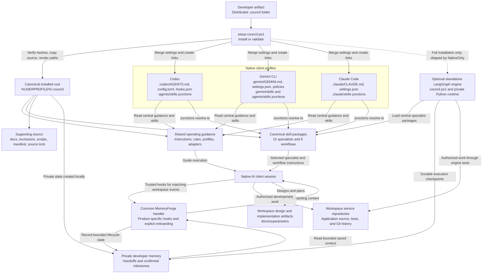

# Council installation and runtime flow

The developer artifact installs one shared Council under `%USERPROFILE%/.council`. Codex, Gemini CLI, and Claude Code use thin native profile pointers and skill junctions to read that same source. The optional Python engine is a separate execution path that also loads the central specialist packages.



## How installation works

The artifact folder is the portable distribution. Each developer runs `setup-council.ps1` with their workspace location. The installer verifies the release hashes, copies the shared source into that developer's profile, and resolves portable paths for their machine. It then merges the Council-owned native settings, registers product-specific hooks, and creates skill junctions that point back to the installed Council. Existing unrelated client settings are preserved. `-NativeOnly` performs this client setup without provisioning the separate Python engine. Each developer receives their own installed root; the artifact directory is not a live network dependency. Before distributing a later revision, the maintainer reconciles shared-source updates into the artifact and refreshes its release hashes; local edits are not automatically exported.

## How the native clients use the Council

When a developer opens Codex, Gemini CLI, or Claude Code, the native profile instructions direct the agent to the central operating guidance and the appropriate product adapter. That guidance provides the common workflow, architecture profile, and authorization rules, while the adapter explains the client's available tools and configuration. The agent discovers the specialist and workflow metadata through its native skill locations, then reads the selected canonical package when needed. Junctions keep the packages shared, so local edits to the installed Council do not require maintaining three copies of each specialist. Specialist packages supply instructions and personas; installing them does not automatically launch independent agents. The native client performs authorized work in the actual service repository, with each repository retaining its own source, tests, and Git history.

## How state and the optional engine fit together

Shared definitions and private execution state have separate lifecycles. Native hooks call the common MemoryForge handler using each product's hook schema, and onboarding restores bounded saved context from the developer's private Council memory. Semantic handoffs are authored explicitly; a generic hook event is not proof that tests passed. The optional LangGraph engine is launched separately through `council.ps1`, uses the same canonical specialist packages, and maintains its own durable execution checkpoints in private memory. Native client task execution does not automatically pass through that engine. Private memory, credentials, backups, and runtime environments are not included in the developer distribution. Native permissions and hook trust remain controlled by each client and any managed policy; static installation checks do not prove fresh client startup or actual hook execution.

## Direcotry Listing
```text
.council/
├── README.md                           		← Overview and installation entry point
├── manifest.json                       		← Version, skill roster, profiles, adapters, and distribution rules
├── source-lock.json                    		← SHA-256 integrity baseline for packaged source
├── .gitignore                          		← Exclusions for private state and generated files
├── setup-council.ps1                    		← Developer installer; supports native-only setup and validation
├── council.ps1                         		← Launcher for the installed Python orchestration engine
│
├── instructions/
│   └── shared.md                       		← Universal Council instructions, authorization, and memory boundaries
│
├── rules/
│   ├── global.md                       		← Host invariants, shell usage, paths, searches, and safe deletion
│   └── workspace.md                    		← Pointer to the selected workspace architecture profile
│
├── profiles/
│   └── fulfillment/
│       ├── profile.json                		← Stack contracts and profile metadata
│       ├── rules.md                    		← EF Core/PostgreSQL, testing, and repository standards
│       └── corporate-architecture-rules.md		← Corporate API, security, deployment, and architecture governance
│
├── adapters/
│   ├── codex.md                        		← Codex instructions, question tools, file links, and permissions
│   ├── codex.json                      		← Codex adapter metadata and portable writable-root binding
│   ├── codex/		
│   │   └── config.toml                 		← Council-owned approval and sandbox defaults
│   ├── gemini.md                       		← Gemini tool boundaries, imports, shell behavior, and policies
│   ├── gemini.json                     		← Gemini adapter metadata
│   ├── gemini/
│   │   ├── settings-fragment.json      		← Portable file-filtering and ignore configuration
│   │   └── policies/
│   │       └── auto-allow.toml          		← Native Gemini execution policy
│   ├── claude.md                       		← Claude Code instructions and lifecycle conventions
│   └── claude.json                     		← Claude Code adapter metadata
│
├── exclusions/
│   └── global.ignore                   		← Shared discovery exclusions
│
├── skills/                             		← 24 canonical packages: 15 specialists and 9 workflows
│   ├── the-architect/SKILL.md           		← Solutions Architecture Lead
│   ├── the-builder/SKILL.md             		← Backend API and automation Lead
│   ├── the-coder/SKILL.md               		← C# Development Lead
│   ├── the-codex/SKILL.md               		← Documentation and Knowledge Lead
│   ├── the-coordinator/SKILL.md         		← Agile Delivery Lead
│   ├── the-curator/SKILL.md             		← Database and Persistence Lead
│   ├── the-gatekeeper/SKILL.md          		← Pre-Submit Quality Gate Lead
│   ├── the-pipelineer/SKILL.md          		← DevOps and CI/CD Lead
│   ├── the-prover/SKILL.md              		← Testing and Validation Lead
│   ├── the-provisioner/SKILL.md         		← Platform Hosting Lead
│   ├── the-purifier/SKILL.md            		← Code Quality and Static Analysis Lead
│   ├── the-relay/SKILL.md               		← Distributed Messaging Lead
│   ├── the-renderer/SKILL.md            		← Frontend UI Lead
│   ├── the-sentinel/SKILL.md            		← Security and Authentication Lead
│   ├── the-watcher/SKILL.md             		← Observability and Telemetry Lead
│   ├── the-council-orchestration/SKILL.md		← Council coordination and review gates
│   ├── brainstorming/SKILL.md          		← Requirements exploration and design
│   ├── writing-plans/SKILL.md          		← Implementation planning and execution handoff
│   ├── systematic-debugging/SKILL.md    		← Root-cause investigation and repair
│   ├── test-driven-development/SKILL.md 		← Failing-test-first implementation
│   ├── verification-before-completion/SKILL.md	← Evidence required before success claims
│   ├── using-superpowers/SKILL.md       		← Workflow discovery and native tool mapping
│   ├── repo-documentation/SKILL.md      		← Architecture documentation maintenance
│   └── handoff/SKILL.md                 		← Semantic checkpoints and session recovery
│
├── council/                            		← Standalone Python orchestration engine
│   ├── README.md                      			← Engine setup, configuration, execution, and recovery
│   ├── __init__.py                      		← Python package initialization
│   ├── __main__.py                      		← Module execution entry point
│   ├── cli.py                          		← Command-line interface and diagnostics
│   ├── config.py                       		← Provider, model, and runtime configuration
│   ├── graph.py                        		← LangGraph orchestration workflow
│   ├── runner.py                       		← Execution and resume coordination
│   ├── checkpoint.py                   		← Durable checkpoint support
│   ├── runtime_context.py              		← Workspace and runtime path resolution
│   ├── specialists.py                  		← Specialist bindings
│   ├── state.py                        		← Shared orchestration state
│   ├── pyproject.toml                  		← Python packaging and console entry point
│   ├── requirements.txt                		← Runtime dependency declarations
│   ├── requirements.lock               		← Pinned dependency constraints
│   └── tools/		
│       ├── file_tools.py               		← Workspace-bound file operations
│       ├── test_runner.py              		← Test-command execution
│       ├── tool_registry.py            		← Engine tool registration
│       └── validator_bridge.py         		← Workspace validation integration
│		
├── docs/		
│   ├── catalog.md                      		← Specialist and workflow catalog
│   ├── setup.md                        		← Developer installation and verification guide
│   ├── structure.md                    		← Distribution source inventory
│   ├── source-contract.md              		← Source ownership, portability, and integrity contracts
│   ├── code-change-pre-submit-sop.md    		← Eleven-phase Pre-Submit Quality Gate
│   └── LangGraph.drawio                		← Editable engine diagram
│
├── scripts/
│   ├── council-codex.mjs                		← Install, validate, onboard, hook, and cleanup CLI
│   ├── council-codex-lib.mjs            		← Shared installation, preservation, and placement logic
│   ├── council-codex-config.mjs         		← Codex defaults and writable-root configuration merging
│   ├── council-memoryforge.mjs          		← Bounded recovery and shared lifecycle memory handling
│   ├── council-source.mjs               		← Source audits and release-lock generation
│   ├── gemini-compat.mjs                		← Version-scoped Gemini repair and protected rollback
│   ├── optimize-gemini-cli.ps1          		← Native wrapper for Gemini compatibility repair
│   ├── install-engine-runtime.ps1      		← Private Python runtime provisioning and validation
│   ├── validate-workspace.ps1           		← Wrapper for the configured workspace integrity validator
│   └── tests/
│       ├── council-codex.test.mjs       		← Installation and lifecycle regression scenarios
│       ├── regression-wrapper.test.mjs 		← Regression integration with the Node test runner
│       ├── council-codex-config.test.mjs		← Native Codex configuration preservation tests
│       ├── codex-workspace-access.test.mjs		← Writable roots, TOML ownership, and metadata recovery
│       ├── council-source.test.mjs      		← Source integrity and memory namespace tests
│       ├── distribution-install.test.mjs		← Actual artifact install, reinstall, and validation
│       ├── gemini-compat.test.mjs			← Compatibility repair, conflicts, and rollback tests
│       ├── gemini-settings-fragment.test.mjs		← Central settings ownership and preservation tests
│       ├── legacy_paths_test.py        		← Legacy path regression checks
│       ├── run-legacy-tests.py          		← Isolated historical regression runner
│       └── engine/                     		← Python engine, packaging, tool, and integration tests
│
├── temp/                               		← Generated test scratch; exclude when packaging
└── work/                               		← Generated verification scratch; exclude when packaging
```
