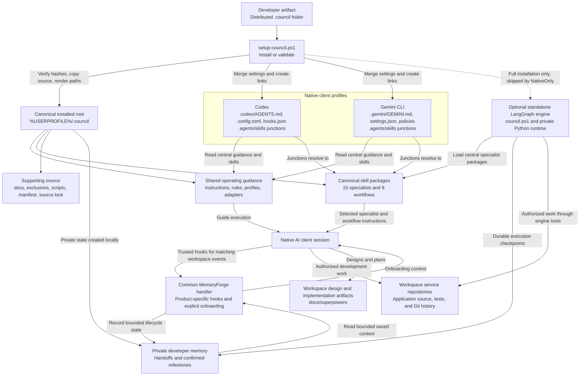

# Council installation and runtime flow

The developer artifact installs one shared Council under `%USERPROFILE%/.council`. Codex and Gemini CLI use thin native profile pointers and skill junctions to read that same source. The optional Python engine is a separate execution path that also loads the central specialist packages.

## How installation works

The artifact folder is the portable distribution. Each developer runs `setup-council.ps1` with their workspace location. The installer verifies the release hashes, copies the shared source into that developer's profile, and resolves portable paths for their machine. It then merges the Council-owned native settings, registers product-specific hooks, and creates skill junctions that point back to the installed Council. Existing unrelated client settings are preserved. `-NativeOnly` performs this client setup without provisioning the separate Python engine. Each developer receives their own installed root; the artifact directory is not a live network dependency. Before distributing a later revision, the maintainer reconciles shared-source updates into the artifact and refreshes its release hashes; local edits are not automatically exported.

## How the native clients use the Council

When a developer opens Codex or Gemini CLI, the native profile instructions direct the agent to the central operating guidance and the appropriate product adapter. That guidance provides the common workflow, architecture profile, and authorization rules, while the adapter explains the client's available tools and configuration. The agent discovers the specialist and workflow metadata through its native skill locations, then reads the selected canonical package when needed. Junctions keep the packages shared, so local edits to the installed Council do not require maintaining two copies of each specialist. Specialist packages supply instructions and personas; installing them does not automatically launch independent agents. The native client performs authorized work in the actual service repository, with each repository retaining its own source, tests, and Git history.

## How state and the optional engine fit together

Shared definitions and private execution state have separate lifecycles. Native hooks call the common MemoryForge handler using each product's hook schema, and onboarding restores bounded saved context from private Council memory. Semantic handoffs are authored explicitly; a generic hook event is not proof that tests passed. The optional LangGraph engine is launched separately through its private Python executable (`-I -m council`), with `council.ps1` available as a wrapper. It loads the same specialist packages and maintains durable private checkpoints. Gemini plans and investigates failures using its existing Google login. New runs send the plan to a separate read-only Codex reviewer using the existing ChatGPT login. Review and revision share bounded inspection receipts, specialist guidance and an explicit workspace-relative plan contract. Rejected protocol-2 revision fields are corrected within the existing revision budget, with bounded private failure context and safe public summaries; invalid candidates never execute. New autonomous runs first review an ordered roadmap of one to eight phases, then plan at most twelve tasks for the current phase. Roadmap review permits four reviews and three revisions; phase review permits four reviews and three revisions, with one strategy reset extending the phase bounds to six reviews and four revisions. Stable phase finding IDs detect two reviews without progress. Earlier monolithic protocol-2 runs retain ordinary six-review/five-revision bounds, extended to eight/seven by their one strategy reset. Initial and revised proposals share deterministic preflight and bounded correction; no rejected proposal reaches a worker. Blockers distinguish user decisions, stalled review, exhausted budget and operational failure; legacy checkpoints retain their original limits. Native Codex workers implement accepted tasks under workspace-write and native approval review. LangGraph recognizes explicitly declared Deno red assertions, freezes their test sources, and requires the paired green rerun before completion. It independently verifies work and controls bounded repairs. Successful verification and workspace audit complete automatically; explicit manual mode retains human plan/final gates. Existing checkpoints preserve their original policy. Inference runs on the providers' hosted services. Native client task execution does not automatically pass through this engine. Private memory, credentials, backups, and runtime environments are excluded from distribution. Native permissions and hook trust remain controlled by each client and managed policy; static checks do not prove fresh startup or hook execution.

Readiness coverage is local to the current phase task plan. Mixed feature phases require a reviewed readiness prefix covering every current-plan implementation task. Prerequisite-only phases may contain only green readiness tasks with empty readiness_for lists, without inventing feature work or referencing future phase IDs. Roadmap revisions retain inspection receipts and human guidance; first and later phases share the same local-state reset. All original inspection responses, including revision and failed attempts, consume one shared 32-round budget before invocation; corrective/transport retries do not add rounds. Workers and failure investigators share accepted task and phase context. The dispatcher validates complete proposed tool batches before execution, and final audit checks current and archived frozen-test evidence. These ordinary setup tasks resolve foreseeable tooling, permissions, dependency, service and authentication prerequisites, then prove the real execution path before implementation dispatch. The existing bounded worker/prover repair flow handles setup; exhausted prerequisite verification stops with READINESS_FAILED. Accepted-plan hashing includes readiness coverage, while absent policy/default task fields preserve historical behavior and hashes. Readiness checks do not replace feature tests or automatically discover unplanned dependencies introduced during coding.

See [setup instructions](setup.md), the [source contract](source-contract.md), and [engine usage](../council/README.md) for installation and execution details.
