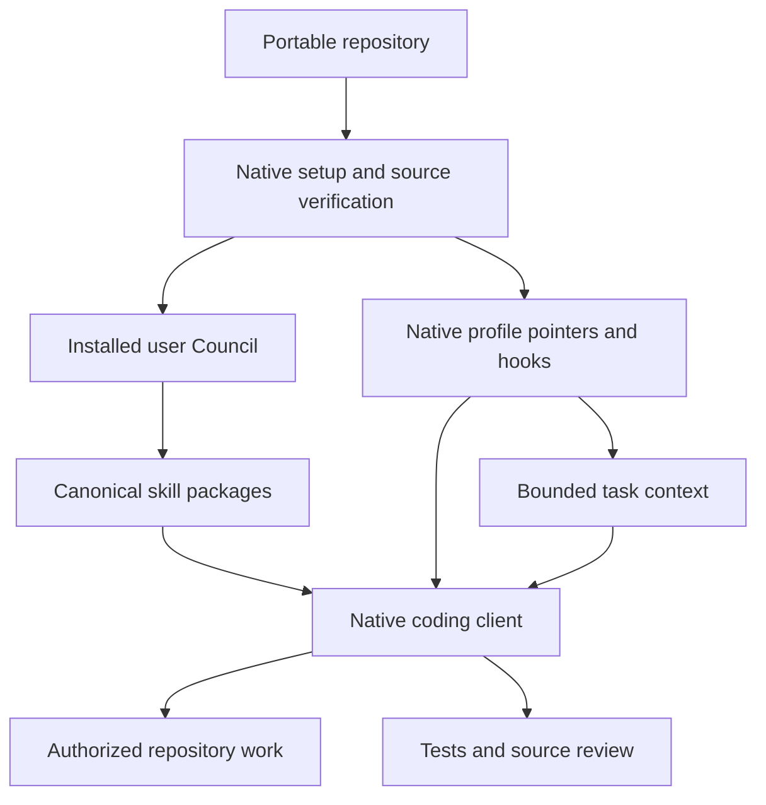

# Native Council architecture

The client executes work through its own tools. Council instructions select relevant roles and workflows. Native subagents are optional and need bounded assignments. A role name can also mean guidance applied inline.

Task history and accepted knowledge have separate lifecycles. Startup context is historical data, not authorization. Knowledge publication requires its own explicit decision. The source includes no separate graph executor or background model service.
